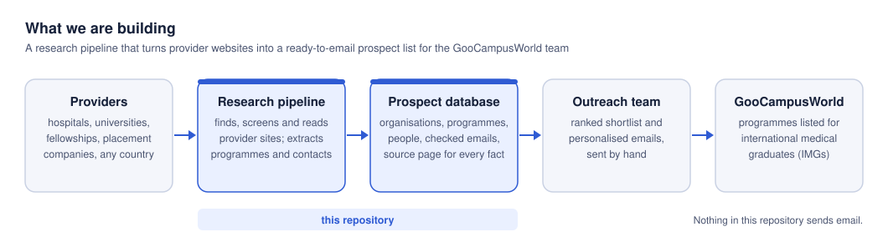

# Global Clinical Outreach

A research and human-reviewed outreach system for **GooCampusWorld**. It finds providers of clinical
observerships, electives, attachments and fellowships for international medical students and graduates,
records sourced programme and contact information, and helps the team review partnership outreach.

**New teammate or Codex session? Start with [the onboarding guide](docs/onboarding.md).**
This is the clean public source distribution. The original repository and its Git history remain
private. See [source provenance and access boundaries](docs/public-source.md).
It explains setup, access, current state and a ready-to-use Codex prompt. Read
[AGENTS.md](AGENTS.md) before making changes.



## What we have built

| System | What it does | Source / instructions |
|---|---|---|
| Country-based research pipeline | Discover → screen → scrape → extract → verify emails → rank → report | [`pipeline/`](pipeline/), [research skill](.agents/skills/research-providers/SKILL.md) |
| Research database and page archive | Supabase prospect records, source URLs, private raw-page storage and reusable local markdown cache | [`supabase/migrations/`](supabase/migrations/), [architecture](docs/architecture.md) |
| Private team dashboard | Published research snapshots, dated outreach aggregates, approved-viewer sign-in | [`web/`](web/), [runbook](docs/pipeline-runbook.md) |
| Outreach review and reconciliation | Versioned drafts, evidence-based review, exact approvals, native Gmail scheduling, Attio tracking | [Outreach workflow](docs/outreach-plan.md) |
| Partnership presentation | Standalone marketing page, assets, design references and visual QA; final main-site integration remains separate | [`marketing/clinical-partnerships/`](marketing/clinical-partnerships/), [handoff](marketing/clinical-partnerships/HANDOFF.md) |
| Guarded operations and checks | Bound Infisical runner, checkout checks, offline Python/Node tests | [TOOLCHAIN.md](TOOLCHAIN.md), [`package.json`](package.json) |
| Synthetic evaluation tooling | Fixed TypeSafe smoke check and bounded window-status pilot; no production inference integration | [Smoke check](docs/typesafe-smoke.md), [pilot](scripts/typesafe-pilot/README.md) |

The repository contains **no email sender or autonomous campaign service**. Gmail delivers messages only
under the separate human approval workflow. Attio is the current correspondence tracker; Supabase
remains the research store. The older Supabase Outreach editor is retained as historical functionality.

## Results and current state

Documentation consolidated **22 October 2026**. These are dated observations, not a fresh live-system check.

| Research batch | Providers | Ready under `bulk-send` |
|---|---:|---:|
| `us-pilot-01` | 24 | 14 |
| `us-02` | 24 | 19 |
| `us-03` | 50 | 47 |
| `us-04` | 13 | 12 |
| `gb-01` | 21 | 20 |
| **Total** | **132** | **112** |

The research dashboard verified on **16 October** contains **224 programmes** and **350 non-invalid
research email records**. “Ready” means research eligibility, not consent to send. The counts changed
since the early pilot reports; [project status](docs/project-status.md) preserves that history.

The **21 October afternoon** check confirmed the five UK messages due that day as Sent and ten future
UK messages scheduled for 22–23 October. GSTT requested a programme discussion and is marked Interested;
no meeting was booked by that check. Three failed US deliveries remain held. The sixth group of twenty
US/UK/Australian drafts remains Awaiting review. A subsequent GSTT meeting-reply draft was shown in chat
on 22 October with a Calendly placeholder; it was not sent or saved as a new Gmail draft by that action.
Reconcile current Gmail/Attio evidence before continuing; elapsed schedule times do not prove a send.

The [hosted dashboard](https://outreach.goocampusglobal.com) requires separately approved access.
Public repository access does not grant access to the dashboard, database, inbox, CRM or secret store.

## How we save API credits

1. **Read local evidence first.** Reuse tracked docs, cached pages and prior results; do not retrieve the
   same source again simply to change a report, extract another field or adjust a targeting rule.
2. **Use built-in and connected tools for supported operations.** Read project mail with scoped native
   Gmail tools, inspect/update CRM through native Attio capabilities, and use GitHub tools or the saved
   `gh` session. No separate enrichment service is needed for those operations.
3. **Use the least costly suitable public retrieval route.** Agent Reach's keyless Exa route and Jina
   Reader come first; connected Exa fills documented gaps. Avoid duplicate sufficient searches.
4. **Spend Firecrawl credits on an identified gap.** Screen and exclude first, target a few relevant
   pages, use plain markdown, and cache it. The agent extracts fields from that cache instead of buying
   Firecrawl JSON/extract output or adding a separate extraction API call.
5. **Verify selectively and evaluate before adopting tools.** Reuse existing email checks and domain
   results. A bounded contact-search pilot found zero verified programme contacts from nine providers;
   it was stopped instead of integrated. TypeSafe remains synthetic evaluation tooling.

See [tools, skills and API-credit policy](docs/tools-and-credits.md) for the routing rules, measured
examples, exceptions and honest cost boundaries. “Built-in” and “keyless” do not mean unlimited or free;
agent subscriptions, tool limits and vendor billing still apply. Historical prices are not current quotes.

## Run locally without production credentials

Prerequisites: Git, Python **3.12+**, `uv`, and a supported Node.js/npm installation.

```sh
git clone https://github.com/maheen-ejaz/global-clinical-outreach-public.git
cd global-clinical-outreach-public
uv sync --frozen
npm ci --ignore-scripts --no-audit --no-fund
npm run check:pr
```

The checks use offline fixtures and an embedded database; they do not run scraping, send mail or need
production keys. They may download dependencies during setup. For a local look at the dashboard shell:

```sh
uv run --frozen python scripts/build-web.py
python3 -m http.server 8000 --bind 127.0.0.1 --directory web
```

Open `http://127.0.0.1:8000`. This serves the sign-in shell, **not demo prospect data**. Do not sign in
against production from localhost or add an auth redirect to make it work. Stop the server with Ctrl-C.
[Onboarding](docs/onboarding.md) covers actual service access and safe contribution.

## Repository guide

| Path | Purpose |
|---|---|
| [AGENTS.md](AGENTS.md) | Repository instructions and invariants for coding agents |
| [docs/onboarding.md](docs/onboarding.md) | Colleague setup, access checklist and Codex starter prompt |
| [docs/codex-handoff.md](docs/codex-handoff.md) | Agent entry point and current operational boundaries |
| [docs/architecture.md](docs/architecture.md) | Components, data flow, trust boundaries and source of truth |
| [docs/tools-and-credits.md](docs/tools-and-credits.md) | Built-in tools, skills, retrieval routing and spend discipline |
| [docs/project-status.md](docs/project-status.md) | Dated decisions, results, lessons, releases and outstanding work |
| [docs/pipeline-runbook.md](docs/pipeline-runbook.md) | Bound commands, dashboard publishing, releases and rollback |
| [docs/outreach-plan.md](docs/outreach-plan.md) | Draft template, review gates, approvals and reconciliation |
| [TOOLCHAIN.md](TOOLCHAIN.md) / [infisical-profiles.json](infisical-profiles.json) | Credential contract and exact allowed operations |
| [`schemas/`](schemas/) / [`config/`](config/) | Input schemas, exclusions, targeting and dashboard-viewer configuration |
| [`scripts/`](scripts/) / [`tests/`](tests/) | Builders, operation guards, evaluation tooling and verification |
| `data/` (ignored) | Private working data, cached pages, exports and correspondence evidence; absent from clones |

## Contribution and publication boundaries

Use an isolated task branch/worktree, preserve unrelated work, run affected checks and `npm run check:pr`,
and update project status when results or decisions change. Never commit private drafts, message bodies,
recipient exports, credentials or ignored working data. Facts keep source URLs; unknown facts stay null.
Never retrieve or automate linkedin.com; search-result profile links require a name/organisation match.

Production commands need separately provisioned access and the guarded runner on clean current canonical
`main`. Do not paste keys into `.env` files or bypass the runner. Netlify sites are manually deployed;
**each publication needs Maheen's explicit release consent**, including previews. This documentation
update does not authorize a website deployment, outreach, follow-up, migration or paid research run.

This public source distribution is for collaboration. No new open-source licence is granted here; preserve
existing vendor/font licences and the marketing asset provenance/usage restrictions.
