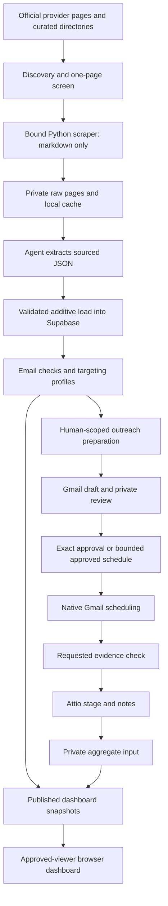

# Architecture and sources of truth

Updated 22 October 2026. The system has a research pipeline and an explicitly operated outreach
workflow. It has no always-on agent, campaign sender or background inbox monitor.

## Research components

| Component | Responsibilities and constraints |
|---|---|
| `pipeline/cli.py` | Research command entry points; batch inputs live in ignored `data/` |
| `pipeline/pages.py` and scraping code | Provider-specific page selection, exclusions/screen enforcement, bounded scrape/cache reuse |
| `schemas/` | Validate discovery/extraction inputs and dashboard aggregates; never replace unknowns with guesses |
| Load/email/targeting modules | Additive sourced records, verification, catch-all detection and read-only ranking |
| `pipeline/dashboard.py` | Build protected snapshots; validate dated private usage/activity inputs and preserve existing observations when absent |
| `supabase/migrations/` | Append-only schema history, RLS, viewer rules and historical activity functionality |
| `scripts/dashboard-template.html`, `scripts/build-web.py`, `web/` | Shared dashboard source, generated static HTML and browser behaviour |

Research tables include organizations, programs, people, emails, news_items, pages and pipeline_runs.
Raw pages also live in private Supabase Storage. The browser reads published `dashboards` snapshots
under approved-viewer policies rather than the underlying prospect tables. The browser publishable key
is intentionally public; service-role/API secrets never belong in browser code or the repository.
Historical activity tables have their own restricted functions/policies; do not generalise their access
to prospect tables.

A complete clone is not a database backup. `data/discovery/`, `data/pages/`, `data/extractions/`,
`data/extra-pages/`, `data/reports/` and `data/outreach/` are ignored local working/evidence directories.
Never reconstruct a supposed live contact list from old screenshots or docs.

## Outreach components and authority

Since 13 October, **Attio Free / GooCampus / Clinical provider outreach** is the correspondence tracker.
Supabase is still the research database. The legacy Supabase Outreach screen/`outreach-activity` runner
exists, but new Attio groups must not be duplicated there or used to justify activating a pending migration.

| Information | Source of truth |
|---|---|
| Programme facts and published contacts | Provider source pages plus cached evidence and sourced research records |
| Eligibility/ranking | Current screen, exclusions and `config/targeting/` rules; eligibility grants no send permission |
| Exact current draft and actual schedule | Native Gmail message/draft details |
| Actual send | Observed Gmail SENT label and message details; scheduled time passing is insufficient |
| Correspondence stage and review history | Current Attio record/stage/notes reconciled against Gmail |
| Human permission | Applicable explicit instruction and exact saved version or bounded schedule authority |
| Dashboard counts | Saved, dated published snapshot, not a live Gmail/Attio sync |
| Current task/release history | Latest applicable entries in `docs/project-status.md` and live ownership |

The private review Page and ignored files contain full versioned text, recipient mappings and evidence.
The public repo keeps workflow descriptions, aggregate results and dated operational history. Requested
checks are participant/thread-scoped; whole-mailbox sync was removed. CRM timestamps alone do not prove
Sent, delivery or inbox placement. A meeting request does not prove a partnership or booked meeting.

## Websites, build and release

The private dashboard (`web/`) and standalone partnership presentation
(`marketing/clinical-partnerships/`) are distinct static Netlify sites with different site IDs.
The partnership builder writes an ignored `dist/`; its `HANDOFF.md`, asset manifest and QA directory
preserve design provenance, usage restrictions and release evidence. Main-platform integration remains
a separate responsibility.

Both sites were verified as manual/no Git repository connection on 22 October. Always recheck before a
future push/release; configuration can change. A documentation PR needs no Netlify deployment. Each
Netlify publication, including previews, requires Maheen's explicit consent for that exact release.
Database snapshot publishing is a separate credential-backed data operation; it is not a static-site deploy.

## Optional evaluations

`docs/typesafe-smoke.md` describes a fixed synthetic request. `scripts/typesafe-pilot/` contains a
bounded synthetic window-status evaluation with offline fixtures, attempt accounting and a readiness
gate. These are development experiments, not a replacement for source extraction or production models.
The Firecrawl People contact pilot is recorded as discontinued after zero source-verified programme
contacts out of nine. Do not infer production adoption from the presence of evaluation files.
